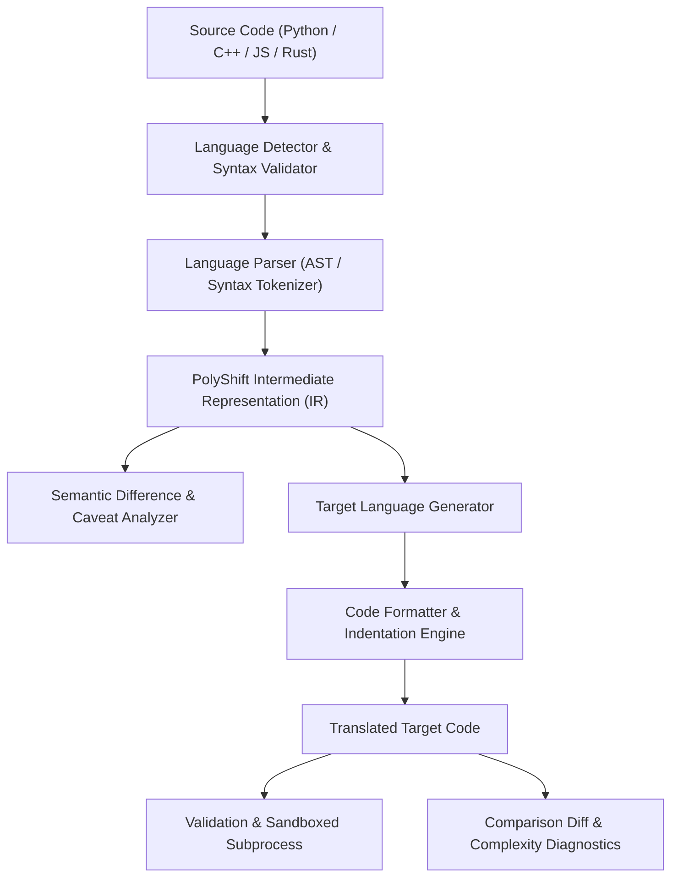

# PolyShift Architecture Specification

## 1. System Overview

PolyShift is a universal, multi-language code translation and intelligence engine engineered for bidirectional conversion across Python, C++, JavaScript, and Rust (all 12 directional permutations).

Rather than superficial regex or LLM-only text replacements, PolyShift uses a hybrid architecture:
1. Source parsing into a semantic **PolyShift Intermediate Representation (IR)**.
2. Abstract Syntax Tree (AST) analysis and construct mapping.
3. Idiomatic target code generation with type resolution.
4. Multi-tier intelligence (complexity metrics, explanation, optimization, visual comparison).
5. Isolated sandboxed validation and subprocess execution.
6. Optional neural augmentation adapter (Gemini / OpenAI) with automatic fallback.

---

## 2. Universal Intermediate Representation (IR)

The Intermediate Representation is defined in `backend/app/engines/ir.py`. It abstracts language specifics into standardized semantic nodes:

### Types (`IRType`)
- **Primitive**: `int`, `float`, `string`, `bool`, `void`, `char`
- **Containers**: `list` (element type), `dict` (key and value types), `set`, `tuple`
- **Modifiers**: `is_mut` (mutability flag), `is_ref` (borrow/reference flag), `is_const`

### Expression Hierarchy (`IRExpression`)
- `Literal`: Constant numbers, strings, booleans, and null/void
- `Identifier`: Variable, argument, or parameter symbol
- `BinaryOp`: Standardized operators (`+`, `-`, `*`, `/`, `%`, `==`, `!=`, `<`, `<=`, `>`, `>=`, `&&`, `||`)
- `UnaryOp`: Negation and boolean inversion (`!`, `-`)
- `FunctionCall` & `MethodCall`: Universal function application and object member invocation
- `ArrayAccess` & `MemberAccess`: Indexing (`arr[i]`) and property access (`obj.prop`)
- `ListLiteral` & `DictLiteral`: Sequence and associative map declarations
- `TernaryExpr`: Conditional expressions (`a if cond else b`)

### Statement Hierarchy (`IRStatement`)
- `VariableDeclaration`: Typed or inferred declaration with initial value
- `Assignment`: Target assignment with operators (`=`, `+=`, `-=`, etc.)
- `ReturnStatement`: Procedure return
- `IfStatement`: Condition, then-body, elif-branches, else-body
- `ForLoop`: Numeric ranges (`range(start, end, step)`) or collection iterations (`for item in collection`)
- `WhileLoop`: Condition-driven loops
- `TryCatch`: Structured exception capture (`try`, `catch/except`, `finally`)
- `BreakStatement` & `ContinueStatement`: Loop control flow

### Program Structure
- `Parameter`: Typed parameter definitions
- `FunctionDef`: Method or standalone procedure definition (with `is_async`, `is_method` attributes)
- `ClassDef`: Object-oriented class/struct definition with fields and methods
- `Program`: Root compilation unit holding imports, classes, functions, and statements

---

## 3. Bidirectional Translation Matrix (All 12 Directions)

| Direction | Primary Semantic Challenges | PolyShift Resolution Strategy |
| :--- | :--- | :--- |
| **Python → C++** | Dynamic typing vs. strict static typing; garbage collection vs. RAII | Type inference from literals and operations; automatic `#include <iostream>`, `<vector>`, `<string>`; `std::cout` stream mapping. |
| **Python → JS** | Indentation vs. braces; None/True/False vs. null/true/false | Explicit block reconstruction; mapping `print` to `console.log`; preserving array comprehension semantics. |
| **Python → Rust** | Ownership, borrowing, and mutability | `let mut` variable declarations; mapping to `Vec<T>` and `String`; wrapping in `fn main()`; borrow-conscious parameters. |
| **C++ → Python** | Pointer types, header files, explicit memory | Stripping redundant type annotations to idiomatic dynamic bindings; mapping `std::vector` to native `list`. |
| **C++ → JS** | Integer bit-width vs. double precision float; RAII | Mapping vector methods (`push_back` → `push`); standardizing loop index bounds. |
| **C++ → Rust** | Classes and inheritance vs. structs and traits | Transforming classes into `pub struct` + `impl` blocks; converting `std::cout` to `println!`. |
| **JS → Python** | `let`/`const` hoisting and truthiness | Converting `const`/`let` to Python variables; replacing `===` with `==`; mapping `console.log` to `print`. |
| **JS → C++** | Dynamic properties and untyped arrays | Inferred vector containers; explicit typing of primitive values; RAII memory encapsulation. |
| **JS → Rust** | Loose typing and closure scope | Strict type binding; `vec!` macro creation; `String::from` allocation. |
| **Rust → Python** | Unwrapping Option/Result; ownership models | Stripping borrow syntax (`&`, `&mut`); transforming `Vec` and `HashMap` to dynamic collections. |
| **Rust → C++** | Pattern matching; memory semantics | Rebuilding struct-impl into C++ classes; translating `println!` placeholders `{}` to `<<`. |
| **Rust → JS** | Strict types and 64-bit integer overflows | Converting `let mut` to `let`, `let` to `const`; translating `println!` to `console.log`. |

---

## 4. Sandboxed Execution Security Architecture

To prevent arbitrary command execution or system compromise:

1. **Subprocess Isolation**: User code is executed inside an ephemeral temporary directory (`tempfile.mkdtemp`).
2. **Resource Boundaries**: Strict execution timeout enforced via `subprocess.run(timeout=EXECUTION_TIMEOUT_SECONDS)`.
3. **Hazard Pattern Filtration**: Regex scan against known attack vectors (`os.system`, `subprocess.Popen`, `child_process`, `fork`, `rmdir`, `unlink`).
4. **Output Buffering**: Standard output and standard error are truncated to 64 KB to eliminate memory flooding attacks.
5. **Deterministic Cleanup**: The isolated directory is completely wiped in a `finally` block via `shutil.rmtree`.
6. **Graceful Fallback**: If a host compiler (e.g. `rustc`) is absent, PolyShift provides syntax verification and a clear diagnostic report rather than crashing.

---

## 5. Database Schema

Managed via SQLAlchemy for SQLite initially, designed for seamless PostgreSQL migration.

- `translation_history`:
  - `id` (Integer, Primary Key)
  - `source_language` (String)
  - `target_language` (String)
  - `source_code` (Text)
  - `target_code` (Text)
  - `translation_status` (String)
  - `confidence_score` (Float)
  - `warnings_json` (Text)
  - `created_at` (DateTime, UTC)
  - `is_bookmarked` (Boolean)
  - `title` (String)
- `example_items`:
  - `id` (Integer, Primary Key)
  - `category` (String)
  - `title` (String)
  - `description` (Text)
  - `python_code` (Text)
  - `cpp_code` (Text)
  - `javascript_code` (Text)
  - `rust_code` (Text)
  - `difficulty` (String)
